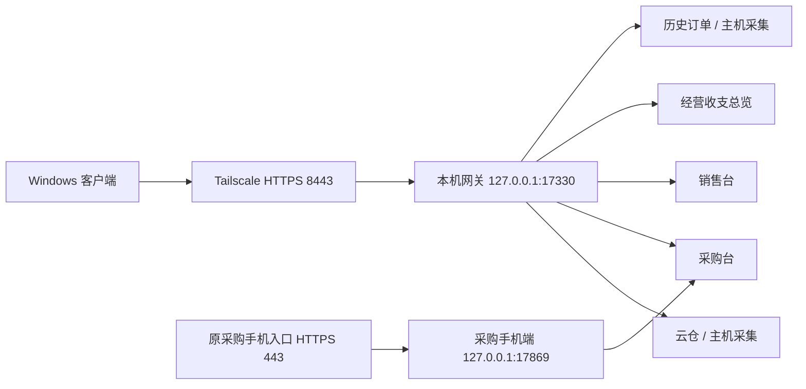

# 五成电子商务工作台：统一私网连接

本版使用当前 Windows 主机保存正式账本。Tailscale 提供私网 HTTPS 连接，业务服务继续负责校验、事务、月份锁定和审计；不传输 SQLite 作为可编辑副本，也不使用网络共享目录作为账本。

截至 2026-10-25 本轮验收，主机和 CQH-RTX3080 均已覆盖安装 **0.10.0**。CQH 现有系统 Tailscale 连接及五模块页面读取通过，原连接关闭错误本轮未再出现，原始原因未独立确认。内置连接已在 CQH 启动并打开官方登录页，等待用户认证及新设备授权；真实双机写入、独立成员和迁移继续单独验收。主机 5 数据库及 415 文件复核无差异。详细证据与历史结果见 [验收记录](workbench-tailscale-acceptance.md)。

## 安装与连接

客户端内置私网连接的 0.10.0 候选实现、登录与新设备授权边界见 [内置连接说明](workbench-embedded-tailnet.md)。候选构建、主机实际安装与真实双机验收分别记录。

1. 在主机更新启动台和五个业务扩展，沿用原账本、附件、登录分区和独立入口。共享 Node.js 与配套浏览器仍由签名模块目录管理。
2. 主机设置选择“主服务器”。启用前显示 Serve 配置差异并保存回滚文件，只增加私网 8443，不修改原 443，也不启用 Funnel。
3. 在主机“成员权限”中按独立 Tailscale 登录身份配置管理员、编辑成员、只读成员、可访问模块及采集发送权。未登记身份拒绝访问。
4. 客户端选择“客户端”，填写一次 `https://设备名.私网名.ts.net:8443`。普通使用不启动本地业务服务、创建本地账本或自动回退到旧通道。
5. 曾在客户端使用独立账本的电脑，应先在单机模式更新原有扩展，确保本机迁移读取接口可用，再准备旧账本迁移。迁移专用读取会使用旧服务，业务采集仍在主机执行。

客户端保留“每天使用／每月填写”首页，采购、销售、总览内嵌显示并保存页面状态。历史订单入口在采购台，总览入口在销售台；远程跳转只使用任务、批次和受控页面路由。

现有主机已通过 `Documents/LingtuWorkbench/workbench-location.json` 绑定原物理配置目录和经过核对的注册表，避免从普通 Explorer 与 Codex/MSIX 上下文启动时读到不同配置。此次只修改已审核的元数据，保留 4 份元数据备份；接入后原业务基线为 **5 个数据库、415 项文件、差异 0**，没有搬移或恢复业务账本。绑定路径、服务器或数据集身份缺失或变化时停止连接，不创建空账本替代。该位置修复与下述旧客户端业务迁移是不同流程。

## 接口与权限

统一前缀是 `/api/workbench/v1`，页面前缀是 `/apps/<module>/`。

| 接口 | 用途 |
| --- | --- |
| `GET /health` | 网关协议、稳定服务器及数据集身份 |
| `GET /session` | 建立受信任 Tailscale 成员会话；返回角色、模块授权、CSRF 和有效期 |
| `GET /modules` | 查询模块版本、状态、账本 UUID 和修订号 |
| `GET /modules/<module>/connection` | 按需启动主机已有服务，验证协议、身份并返回安全连接信息 |
| `/modules/<module>/<原始 API 路径>` | 转接清单登记的完整业务接口 |
| `GET /capabilities` | 发现已登记操作及主机专属功能 |
| `GET /operations/<key>?module=<module>` | 查询幂等结果；未知结果需核对，不盲目重复提交 |
| `/migrations` | 隔离上传、逐项选择、两次确认、事务迁移、结果和中断恢复 |

完整的方法、原接口、权限分类及可远程范围见 [接口覆盖清单](workbench-interface-coverage.json)。新增接口默认拒绝远程使用，须明确登记。CLI/MCP 复用同一通道与校验，支持完整只读业务查询和受控草稿，不提供绕过界面确认的提交参数。

所有业务后端仍只监听回环地址。网关仅接受 Tailscale Serve 转交的身份，转发时生成短时、绑定模块、方法、完整路径和实际操作人的 HMAC 身份；客户端提供的伪造代理头会被拒绝。浏览器会话使用 Secure、HttpOnly、SameSite Cookie，修改请求必须通过来源、CSRF、角色和幂等检查。原手机配对和 CSRF 继续有效，并读取同一成员策略。

服务器、成员、全局数据集和各模块账本 UUID 均受绑定检查；更换账本不会被当作空数据继续写入。数据库身份随账本持久保存，不从用户名、磁盘路径或 PID 推断。

模块安装、升级、受控停止、备份恢复、任意本机文件路径、Windows 安全存储、登录分区和密钥配置均属主机功能。文件上传使用字节流，下载使用受控文件标识，不能把客户端路径当作服务器路径。

## 旧账本迁移

1. 识别每个已有账本的所有业务表及原件，不因订单或主流水为空而忽略费用、供应商、历史或其他业务记录。源数据库和允许的附件目录先在来源电脑备份。
2. 上传业务快照及经过摘要校验的原件到隔离暂存区。上传凭据绑定成员与会话；Cookie、密码、DPAPI 分区和模块密钥不参与传输。
3. 管理员逐项比较来源、已有和拟入账内容。完整重复跳过；冲突字段默认保留原值，空白不能覆盖非空内容。新增记录、未知金额、锁定月份及未确认账号必须处理完成后，才能确认整批。
4. 第二页按模块、账期、币种及原统计口径核对金额、记录和原件数量。修改后原确认作废，两次确认必须属于同一成员、会话及修订版本。
5. 在唯一维护窗口中冻结相关主机服务，先备份所有关联账本，再按依赖顺序执行事务及逐项读取校验。采购、销售的新标识在确认前预留；总览引用使用经过核对的映射，不沿用客户端本地行 ID。
6. 失败时在开放写入前一致恢复；恢复失败则继续保持维护。任何模块开始开放后，中断恢复只能完成维护开放，不能再次整库回退覆盖后来的编辑。
7. 服务器整批完成后，来源客户端冻结本地旧服务，再次核对原始业务快照，保存服务器回执并封存旧账本。此后客户端才允许在线录入。源资料仍留在原电脑；发生新变化或出现新账本时会阻止封存。

正式完成的迁移不能通过中断恢复接口整库回滚。后续业务更正须在所属模块核对差异、月份锁定及后续编辑，按原业务流程处理并保留审计。

## 离线与人工处理

离线快照限于成功认证读取的库存、近期采购订单、上一销售账期流水及报表、经营看板和采集任务状态。缓存按成员、服务器、数据集隔离，使用 Windows safeStorage/DPAPI 加密，不提供明文备用存储。缓存明确显示时间，禁止录入、导入确认或执行任务；附件按需下载。

主机登录、验证码、扫码和平台授权须在主机操作。客户端显示“等待主服务器人工处理”，工作台自身不提供远程桌面；本轮客户端准备使用的系统 RDP 是独立连接。主机关机、休眠或退出运行会话时显示不可用；关闭工作台窗口不会停止已启动的网关和业务后台。

0.9.1 完整离线包已验证外层安装器、七个签名模块、完整依赖图和共享运行环境启动，验证期间不调用网络。文件为 `Lingtu-0.9.1-Complete-Offline-Windows-x64.zip`，摘要见同目录版本校验清单及验收记录。包内文档保留构建时快照，本页后续进度更新不改变既有离线归档；离线包通过不代表 CQH 或无环境新电脑的安装已经完成。

## 网络切换与验收边界

Tailscale Grants 是叠加授权；较窄的新规则不会覆盖旧的宽规则。本轮管理员已保存 **5 条 Grants、12 项策略测试**，并核对 [主机实际生效 netmap](../dist/module-verification/workbench-network-policy-2026-10-25.json)：TCP 8443 的 IPv4/IPv6 来源仅主机与 CQH，原手机 TCP 443 规则保持。既有相邻 TCP 范围已排除 8443，其他原有 TCP、UDP 和 ICMP 授权未在此次范围内收紧；未启用 Funnel，不能把本次结果扩大成整个私网最小授权。

普通 Explorer 启动后的真实 443/8443 均返回 HTTP 200，转发目标未变。CQH 与主机目前使用同一 Tailscale 成员身份，仍须完成客户端版本与连接核验、跨设备新连接和实际业务操作，以及独立管理员、编辑者、查看者与未授权成员的应用权限验收。设备级网络范围验证不替代独立成员验证。

主机安装、后台保存策略、CQH 的 Taildrop 送达及用户安装回执见 [本轮现场观察记录](../dist/module-verification/workbench-session-observations-0.9.1.json)；该记录不是独立设备审计，远端安装器摘要未独立核实。CQH 已保存客户端模式，但界面的在线模式说明不能代替请求成功证据。当前等待只读 DNS 与 HTTPS 普通请求、指定解析对照；FlClash 系统代理及 TUN 可见，故障原因尚未确认。0.9.2 的专用私网会话直连候选尚未在 CQH 验收，也不绕过操作系统 TUN。

原 Cloudflare 通道在过渡期保留。正式切换前停止旧写入口，真实双机、不同成员验收通过后再停用旧业务通道，不能用本机 HTTPS 模拟结果代替。

已完成的自动验收覆盖实际三个账本服务、真实界面两次确认、原件上传下载、原生 Electron 内嵌切换、Windows DPAPI 和断网快照、权限及幂等、故意校验失败和多库恢复。真实双机、独立成员身份、真实平台采集及消息发送另行记录，测试中没有操作真实账本或发送业务消息。

0.9.1 原生客户端首次隔离运行出现 `markResourceTiming` 错误；诊断运行和未改产品代码的原样重试通过，但首次失败根因仍未确认，不能记为已修复。正式旧账本迁移与 Cloudflare 旧写入口冻结、停用和切换均尚未执行。

参考： [Tailscale Serve](https://tailscale.com/docs/features/tailscale-serve)、[Grants 语法](https://tailscale.com/docs/reference/syntax/grants)、[Fastify 官方代理组件](https://github.com/fastify/fastify-reply-from)。
